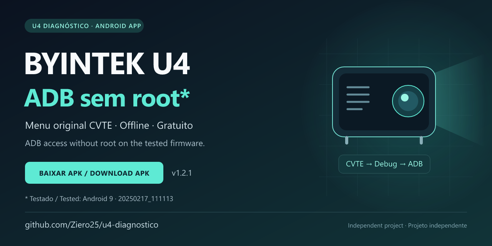

<div align="center">



# BYINTEK U4 — ADB access and diagnostics

**Access the ADB option through the original CVTE menu, without root on the tested firmware.**

**U4 Diagnóstico** is a free, offline Android helper for the BYINTEK U4 projector. Open the identified factory menu, enable ADB manually and export a local diagnostic report when needed.

**Confirmed on one unit running Android 9 and firmware `20250217_111113`.**

[Português](README.md) · **English**

[](https://github.com/Ziero25/u4-diagnostico/releases/tag/v1.2)
[](LICENSE)
[](docs/en/COMPATIBILITY.md)
[](docs/en/PRIVACY.md)

### [Download APK 1.2](https://github.com/Ziero25/u4-diagnostico/releases/download/v1.2/U4-Diagnostico-1.2.apk)

[Get started](docs/en/USAGE.md) · [FAQ](#frequently-asked-questions) · [Compatibility](docs/en/COMPATIBILITY.md) · [Privacy](docs/en/PRIVACY.md) · [Build](docs/en/DEVELOPMENT.md)

</div>

---

## What it does

| Feature | Behavior |
| :--- | :--- |
| **CVTE menu shortcut** | Requests the original technical menu so you can access the ADB option. |
| **Component verification** | Checks the menu version, signing certificate and service access before calling it. |
| **Local diagnostic ZIP** | Collects selected technical details and readable settings APKs into one file on the device. |
| **Offline operation** | The helper does not declare the Android internet permission. |

The menu opened on the tested unit, the owner enabled ADB manually, and a computer successfully connected over the local network. Other hardware and firmware revisions require their own verification.

## Get started in four steps

1. **Install** the [release APK](https://github.com/Ziero25/u4-diagnostico/releases/tag/v1.2), for example from a USB drive.
2. **Open** U4 Diagnóstico and select **Abrir menu CVTE identificado no seu projetor** — “Open the CVTE menu identified on your projector”.
3. **Enable** only **Debug → ADB Enable → On** in the original menu.
4. **Exit** with **Back**, then connect the computer to the projector's IP address on port `5555` for this firmware.

The APK interface remains in Portuguese. This documentation provides English guidance without changing the released app.

> [!IMPORTANT]
> Change only **ADB Enable**. Other factory menu options include resets, panel settings, motors and calibration and may misconfigure the device. When finished, set **ADB Enable → Off** and verify that access has stopped.

**Fechar menu CVTE** closes the technical window; it does not disable ADB. See the [usage guide](docs/en/USAGE.md) for connection steps and troubleshooting.

## Tested configuration

| Item | Observed value |
| :--- | :--- |
| Commercial model | BYINTEK U4 |
| Android | 9 · API 28 |
| Platform | HiSilicon Hi3751V350 · `bigfish` |
| Firmware shown by the device | `20250217_111113` |
| Menu package | `com.cvte.fac.menu`, version `1.2.70` |
| Root requirement for this shortcut | None on the tested configuration |

The model name or processor alone does not establish compatibility. The helper also verifies the component's signing certificate and refuses a mismatched contract. [Checks and limitations →](docs/en/COMPATIBILITY.md)

## Frequently asked questions

### How do I enable ADB on the BYINTEK U4?

On the tested firmware, install the APK, select **Abrir menu CVTE identificado no seu projetor**, then set **Debug → ADB Enable → On** in the original menu. Exit with **Back** and follow the [connection guide](docs/en/USAGE.md#3-connect-a-computer). The helper opens the menu; it does not switch ADB on automatically.

### Developer options are missing. Can this help?

The helper uses a specific CVTE menu service instead of the standard Android developer settings screen. It verifies the version and certificate before calling the service. This worked on the [documented configuration](docs/en/COMPATIBILITY.md); support for other revisions is unconfirmed.

### Projectivy opens only the manufacturer's settings. What can I try?

That happened on the unit used for this project. The helper's **Abrir menu CVTE identificado no seu projetor** button uses the specific route that worked there. You do not need to replace your launcher to use it.

### Does it need root or a firmware update?

The CVTE shortcut requires neither root nor replacement firmware on the tested configuration. A `userdebug` build does not by itself establish that root access is available.

### Does it work with every U4 or Android projector?

No universal compatibility has been confirmed. The real-device test covered one BYINTEK U4, Android 9, firmware `20250217_111113`, with CVTE menu version `1.2.70` and the documented signing certificate. Other revisions need separate analysis. The helper blocks components that do not match the reviewed contract.

### Will enabling ADB improve performance or picture quality?

ADB enables diagnostic access and separate adjustments. Enabling it does not automatically improve the device. This helper does not apply performance tweaks, remove apps or change picture calibration.

### How do I disable ADB afterwards?

Return to the original menu and set **Debug → ADB Enable → Off**. Closing the menu or uninstalling the helper does not disable ADB. Follow the [verification steps](docs/en/USAGE.md#4-end-access).

### Is it free, and where should I download it?

Yes. The source is available under [MIT](LICENSE), and the [APK is attached to this repository's release](https://github.com/Ziero25/u4-diagnostico/releases/tag/v1.2). Check the published SHA-256 after downloading. This is an independent project, not an official BYINTEK or CVTE app.

## Your report stays on the device

The report is saved to:

```text
Download/U4-Diagnostico/U4-diagnostico.zip
```

It includes selected technical information, a system-app inventory and readable copies of settings packages. It does not copy those apps' private data or upload the ZIP automatically.

**Do not post diagnostic ZIPs in public issues.** They may contain installation-specific details and proprietary manufacturer software. Read the [privacy and permissions guide](docs/en/PRIVACY.md).

## Development

The project uses Java, Android SDK tools and PowerShell scripts, without Gradle.

```powershell
.\test.ps1
.\build.ps1 -SdkPath "$env:LOCALAPPDATA\Android\Sdk"
```

The validated environment uses JDK 21, Android Platform 35 and Build Tools 34.0.0. The local tests cover 26 checks of component identity, commands and ADB-state restoration. [Environment, build and signing instructions →](docs/en/DEVELOPMENT.md)

<details>
<summary><strong>Verify the published APK</strong></summary>

SHA-256 of `U4-Diagnostico-1.2.apk`:

```text
a72044cc22f8cadd87a3e589926ff9a5d3ae353961394849ffb8503bbceb3187
```

```powershell
Get-FileHash .\U4-Diagnostico-1.2.apk -Algorithm SHA256
```

Compare with [downloads/SHA256SUMS.txt](downloads/SHA256SUMS.txt) or the checksum attached to the [release](https://github.com/Ziero25/u4-diagnostico/releases/tag/v1.2).

</details>

## Documentation

| Guide | Contents |
| :--- | :--- |
| [Usage](docs/en/USAGE.md) | Installation, ADB menu, report export and troubleshooting. |
| [Compatibility](docs/en/COMPATIBILITY.md) | Tested revision, service contract and limits. |
| [Privacy](docs/en/PRIVACY.md) | Collected data, permissions and report handling. |
| [Development](docs/en/DEVELOPMENT.md) | Tools, tests, build, signing and contributions. |
| [Version history — Portuguese](CHANGELOG.md) | Changes between app versions. |

## License

**Free and open source under the [MIT license](LICENSE).** Retain the copyright and license notices when sharing the project. The software is provided without warranty.

The license covers this project's original code and materials. Manufacturer APKs that a report may copy remain subject to their owners' licenses and are not distributed in this repository.

<div align="center">

Maintained by [Ziero25](https://github.com/Ziero25) · Independent project, not affiliated with BYINTEK or CVTE.

</div>
