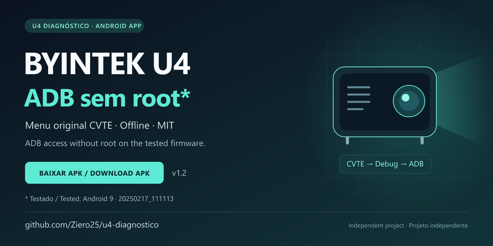

<div align="center">



# BYINTEK U4 — acesso ao ADB e diagnóstico

**Acesse a opção ADB pelo menu original CVTE, sem root na revisão testada.**

O **U4 Diagnóstico** é um auxiliar gratuito e offline para o projetor BYINTEK U4. Abra o menu identificado no firmware, ative o ADB manualmente e gere um diagnóstico local quando precisar investigar o aparelho.

**Testado em uma unidade com Android 9 e firmware `20250217_111113`.**

**Português** · [English](README.en.md)

[](https://github.com/Ziero25/u4-diagnostico/releases/tag/v1.2)
[](LICENSE)
[](docs/COMPATIBILIDADE.md)
[](docs/PRIVACIDADE.md)

### [Baixar APK 1.2](https://github.com/Ziero25/u4-diagnostico/releases/download/v1.2/U4-Diagnostico-1.2.apk)

[Começar a usar](docs/USO.md) · [Perguntas frequentes](#perguntas-frequentes) · [Compatibilidade](docs/COMPATIBILIDADE.md) · [Privacidade](docs/PRIVACIDADE.md) · [Compilar](docs/DESENVOLVIMENTO.md)

</div>

---

## O que ele faz

| Recurso | Como funciona |
| :--- | :--- |
| **Atalho para o menu CVTE** | Abre a janela técnica original para você acessar a opção ADB. |
| **Conferência do componente** | Verifica versão, certificado e acesso ao serviço antes de chamá-lo. |
| **Diagnóstico em um arquivo** | Reúne dados técnicos e APKs de configurações em um ZIP salvo no aparelho. |
| **Funcionamento offline** | O auxiliar não possui permissão de acesso à internet. |

O acesso foi confirmado em **uma unidade BYINTEK U4 com Android 9**, firmware `20250217_111113`. O menu abriu, o usuário ativou a opção ADB e a conexão pela rede funcionou. Outras revisões precisam de verificação própria.

## Comece em quatro passos

1. **Instale** o [APK da release](https://github.com/Ziero25/u4-diagnostico/releases/tag/v1.2), por exemplo usando um pendrive.
2. **Abra** o U4 Diagnóstico e escolha **Abrir menu CVTE identificado no seu projetor**.
3. **Ative** somente **Debug → ADB Enable → On**, dentro do menu original.
4. **Saia** com **Voltar** e conecte o computador ao IP do projetor, na porta `5555` nesse firmware.

> [!IMPORTANT]
> Use somente **ADB Enable**. As outras opções do menu original incluem reset, painel, motores e calibração e podem desconfigurar o aparelho. Ao concluir, coloque **ADB Enable → Off** e confira se a conexão foi encerrada.

O botão **Fechar menu CVTE** fecha a janela técnica. Ele não desliga o ADB que você tenha ativado. Veja o [guia de uso](docs/USO.md) para os passos completos e solução de problemas.

## Feito para uma revisão conhecida

| Item | Identificação conferida |
| :--- | :--- |
| Sistema testado | Android 9 · API 28 |
| Plataforma da unidade testada | HiSilicon Hi3751V350 · `bigfish` |
| Firmware exibido no aparelho | `20250217_111113` |
| Componente do menu | `com.cvte.fac.menu`, versão `1.2.70` |
| Acesso ao atalho | Sem exigir root |

O nome **U4** ou o processador sozinho não confirma compatibilidade. O aplicativo também confere a assinatura do componente e bloqueia a chamada quando ela diverge. [Entenda as verificações e os limites →](docs/COMPATIBILIDADE.md)

## Perguntas frequentes

### Como ativar ADB no BYINTEK U4?

Na revisão testada, instale o APK, escolha **Abrir menu CVTE identificado no seu projetor** e altere **Debug → ADB Enable → On** no menu original. Saia com **Voltar** e siga o [guia de conexão](docs/USO.md#3-conectar-o-computador). O app abre o menu; a ativação é manual.

### As opções de desenvolvedor não aparecem. Esse app ajuda?

O auxiliar usa um serviço específico do menu CVTE, sem depender da tela padrão de opções de desenvolvedor do Android. Ele confere a versão e o certificado antes da chamada. O resultado foi confirmado somente na [revisão documentada](docs/COMPATIBILIDADE.md).

### O Projectivy abre apenas as configurações do fabricante. O que fazer?

Foi o comportamento observado na unidade usada neste projeto. Nesse caso, o botão **Abrir menu CVTE identificado no seu projetor** oferece o caminho específico que funcionou. Não é necessário trocar o launcher para usar o auxiliar.

### Precisa de root ou de uma atualização de firmware?

O atalho CVTE funciona sem root na revisão testada e não requer instalar outro firmware. A classificação `userdebug` do sistema não significa, por si só, que exista root disponível.

### Funciona em qualquer U4 ou projetor com Android?

Ainda não há essa confirmação. O teste real foi feito em uma unidade BYINTEK U4, Android 9, firmware `20250217_111113`, com `com.cvte.fac.menu` versão `1.2.70` e o certificado documentado. Outras revisões precisam de análise própria. O app bloqueia componentes que não correspondem ao contrato conhecido.

### Ativar ADB melhora o desempenho ou a imagem?

Ativar ADB permite acessar ferramentas de diagnóstico e executar ajustes separados; não melhora o aparelho automaticamente. O U4 Diagnóstico não aplica otimizações, não remove apps e não altera a calibração da imagem.

### Como desativar ADB depois?

Volte ao menu e selecione **Debug → ADB Enable → Off**. Fechar o menu ou desinstalar o auxiliar não desliga o ADB. Confira o encerramento com os passos do [guia de uso](docs/USO.md#4-encerrar-o-acesso).

### O aplicativo é gratuito? Onde baixar com segurança?

Sim. O código é aberto sob [MIT](LICENSE), e o [APK está nos anexos da release deste repositório](https://github.com/Ziero25/u4-diagnostico/releases/tag/v1.2). Compare o SHA-256 com o checksum publicado. O app é independente, sem vínculo oficial com BYINTEK ou CVTE.

## Seus dados ficam no aparelho

O diagnóstico é salvo em:

```text
Download/U4-Diagnostico/U4-diagnostico.zip
```

Ele inclui informações técnicas selecionadas, inventário de apps de sistema e cópias dos programas de configurações que puderem ser lidos. O auxiliar não copia dados privados desses aplicativos nem envia o ZIP automaticamente.

**Relatórios de diagnóstico não devem ser publicados em issues públicas.** Eles podem conter informações específicas do aparelho e software proprietário do fabricante. Consulte a [descrição dos dados e permissões](docs/PRIVACIDADE.md).

## Para desenvolver

O projeto usa **Java e Android SDK**, com scripts PowerShell. Não depende de Gradle.

```powershell
# Executar as verificações locais
.\test.ps1

# Gerar um APK com assinatura local de desenvolvimento
.\build.ps1 -SdkPath "$env:LOCALAPPDATA\Android\Sdk"
```

O ambiente validado usa **JDK 21**, **Android Platform 35** e **Build Tools 34.0.0**. Os testes cobrem **26 verificações** de identidade, comandos e restauração de estados ADB.

[Preparar o ambiente, compilar e assinar →](docs/DESENVOLVIMENTO.md)

<details>
<summary><strong>Verificar o APK publicado</strong></summary>

SHA-256 de `U4-Diagnostico-1.2.apk`:

```text
a72044cc22f8cadd87a3e589926ff9a5d3ae353961394849ffb8503bbceb3187
```

No PowerShell:

```powershell
Get-FileHash .\U4-Diagnostico-1.2.apk -Algorithm SHA256
```

O arquivo de checksums está na [release](https://github.com/Ziero25/u4-diagnostico/releases/tag/v1.2) e em [downloads/SHA256SUMS.txt](downloads/SHA256SUMS.txt).

</details>

## Navegue pelo projeto

| Documento | Conteúdo |
| :--- | :--- |
| [Guia de uso](docs/USO.md) | Instalação, menu ADB, diagnóstico e problemas comuns. |
| [English documentation](README.en.md) | English overview, FAQ and guides. |
| [Compatibilidade](docs/COMPATIBILIDADE.md) | Revisão testada, contrato do serviço e limitações. |
| [Privacidade](docs/PRIVACIDADE.md) | Dados coletados, permissões e cuidado com os relatórios. |
| [Desenvolvimento](docs/DESENVOLVIMENTO.md) | Ambiente, testes, compilação e assinatura. |
| [Histórico](CHANGELOG.md) | Evolução das versões do auxiliar. |
| [Como contribuir](CONTRIBUTING.md) | Relatos úteis e alterações no código. |

## Licença

**Gratuito e de código aberto, sob a [licença MIT](LICENSE).** Você pode usar, modificar e redistribuir o código, inclusive comercialmente, preservando os avisos de autoria e licença. O software é fornecido sem garantia.

A licença cobre o código e os materiais autorais deste projeto. Os APKs do fabricante eventualmente copiados pelo diagnóstico permanecem sujeitos às licenças dos respectivos titulares e não são distribuídos neste repositório.

<div align="center">

Mantido por [Ziero25](https://github.com/Ziero25) · Projeto independente, sem vínculo oficial com BYINTEK ou CVTE.

</div>
